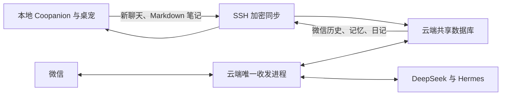

# Coopanion 共享经历与云端微信

本地使用官方 Coopanion v0.2.6 / Cortico；云端继续使用原来的 Python / Hermes / DeepSeek 服务。微信凭据与收发进程仅存在于云端，本地不重新绑定 iLink。本地退出或电脑关机不会中断云端聊天。

## 人设与历史

- 同步迁移时保留本地 `CONSTITUTION.md` 原文。后续用户明确要求的口癖与格式修订见下节。同步安装时在私有目录保存同字节快照；云端首次配对锁定该快照，以后不同内容会被拒绝，不会悄悄覆盖。
- 云端使用这份 Coopanion 人设卡；停用原大肥鱼的风格示例、口吻后处理和自动人格成长。两种框架、各自历史和工具不同，仍可能产生措辞差异。
- 原记忆、聊天和日记作为带来源的经历使用，不作为替换人格的指令。人设卡中的旧试用环境备注由独立运行环境说明更新，不改卡本身。
- 数据库中的失败、待确认和被替换草稿完整归档，但不作为已成功发送的助手消息导入桌面聊天。

## 数据流



扩展源代码在 `integrations/coopanion/`；本机已复制到便携应用数据目录下的 `extensions/node_modules/cortico-world-dafeiyu-sync/`，并登记为直接依赖。`tools/companion_sync_transport.py` 是独立 stdio 传输进程，固定访问 `/companion/sync`。SSH 校验已固定的主机公钥，核心 HTTP 端口继续仅绑定云端回环地址；没有新增公网 API。

云端接口在 `little_blue/companion.py`，要求原核心 Bearer 认证，并拒绝浏览器 Origin。配对仅允许一个桌面客户端；客户端 ID 与已确认游标保存在本地 `data/dafeiyu-sync.json`，不要单独删除。

本地 SSH 传输需要额外依赖：在项目 Python 环境运行 `python -m pip install -e ".[companion]"`。云端核心不需要安装这组本地传输依赖。

正常每 5 秒同步一次，网络重连或积压时可能更久。事件以客户端 ID + 原事件游标去重，服务端确认后才推进本地游标。导入历史不唤醒模型、不重新执行旧工具、不回传形成循环；重启时还会扫描已导入事件修复中断窗口。

本地笔记只同步工作区内普通 Markdown 文件，跳过点目录、符号链接、人设卡、`shared/` 和 `imported/`。云端保留笔记旧版本；删除本地笔记会撤下云端当前副本，旧版本仍可恢复。云端将相关笔记加入聊天背景；桌面可用以下工具查询状态和历史：

- `shared_memory_status`：最近成功同步、微信连接、待同步游标与数量。
- `shared_memory_search`：按关键词搜索记忆、已确认聊天和日记；关键词检索不是语义向量搜索。

## 文件位置

以下均相对项目根目录，运行数据与密钥不进入 Git：

| 内容 | 路径 |
|---|---|
| 本地配置 | `.research/Coopanion/data/home/companion/config.json` |
| 原人设卡 | `.research/Coopanion/data/home/companion/workspace/CONSTITUTION.md` |
| 云端使用的原文快照 | `.secrets/coopanion-persona.txt` |
| SSH 连接配置 | `.secrets/companion-connection.json` |
| 同步客户端 ID、游标、缓存 | `.research/Coopanion/data/home/companion/data/dafeiyu-sync.json` |
| 原始迁移记录 | `.research/Coopanion/data/home/companion/workspace/shared/archive.json` |
| 可读记录索引 | `.research/Coopanion/data/home/companion/workspace/shared/INDEX.md` |
| 安装前本地备份 | `backups/coopanion-before-sync-*.zip` |

`shared/history/` 按月保存原话、原时间、渠道与发送状态；`shared/memories/` 保存记忆及状态；`shared/diaries/` 保存日记。不要在 `shared/` 中手动改记录，该目录由同步器维护。

## 离线、重启与恢复

本地断网后仍可查已下载的记录，新聊天先留在本地事件日志，恢复连接再补传。云端看到的是最近成功同步的数据；它不会取得未同步的文件、实时屏幕或鼠标控制。即使本地在线，微信通道目前也不转发电脑操作，仍应在桌宠中发起并遵循原有每轮授权。

云端服务重启后，iLink 需要用户发一条新微信才能恢复发送上下文；本地应用重启不会重启云端微信，也不需要重新扫码。微信的主动发送仍受已有发送会话、限频和勿扰设置约束。

更新扩展时先备份本地应用数据，复制扩展源码，再使用应用的重启与刷新会话前缀操作。保留原人设快照和客户端状态。恢复同一实例时应恢复完整本地数据，不要用新生成的客户端 ID 覆盖云端配对。

停用同步可将本地 `worlds.dafeiyu-sync.enabled` 设为 `false` 并重启应用；这不会停止云端微信或删除已迁移内容，也不会恢复旧人设。需要更换人设、解除配对或切换云端人格时应单独明确操作。

## 本次验收

- 部署前核心数据库与完整数据卷均有备份；原有记录逐条对比保留。
- 部署时保留 135 条记忆、143 条聊天、2 篇日记；继续聊天后数量会增长。
- 人设文件与快照的 SHA-256 一致；本地和云端使用同一份原文。
- 服务端与相关功能测试 114 项通过，扩展离线重试/防循环测试 2 项通过。
- 云端合成数据验收通过：认证、重复请求去重、人设变更拒绝；公开网页读取成功。
- 用户实际发来的微信已由云端回复，发送状态为 `delivered`；本地 DeepSeek 实际调用共享记忆工具检索到同一轮聊天。

两端依旧是各自运行的模型会话，尚未合并实时推理、工具权限或桌面控制。共享的是已确认的经历和笔记，不是模型内部思考过程。

## 2026-10-22：短消息规则

用户明确要求取消句尾“库”的口癖、每条不换行、每条最多 30 个字。仅替换人设卡中原口癖段落，其他性格描述保留；本地卡、私有快照与云端配对配置同步更新，旧版有备份。通常发 1 条，确有需要时发 2 条独立消息，不为凑条数重复。

微信发送边界用 `little_blue/chat_format.py` 拆分文本，标点和空格计入 30 字，Unicode 按码点计数。分段依序发送，遇到未确认发送立即停止且不自动重试；历史发送状态仍以整轮是否全部完成为准。超长链接同样受长度上限约束，拆开后可能不再能直接点击完整地址。

本地对官方 `pet_say` 解析后的气泡加了同样的长度约束，保留动作和内联动画位置；`pet_ask` 超长或带换行时返回提示，让模型改成短问题再调用。原始云端历史归档不改，新增导入的聊天按短气泡展示。窗口太窄时界面仍可能自然折行，这与消息正文包含换行不同。

本地程序更新后，需要重新应用补丁并重启、刷新会话前缀：

```powershell
.\.venv\Scripts\python.exe tools/patch_coopanion_chat.py .research/Coopanion
```

补丁工具会检查上游代码位置，保留原文件副本，并兼容扩展被 npm/pnpm 安装成硬链接的情况；源码结构变化时停止，不能强行覆盖。

验收：相关 Python 测试 72 项、Node 测试 4 项通过；追加发送锁检查 7 项通过。本地真实回复拆成 14 字与 26 字两条；用户微信触发的云端真实回复为 15 字，发送成功、无换行、无口癖。
