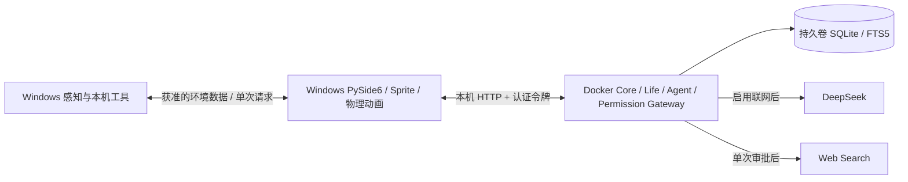

# Docker 核心服务与 Windows 桌面端

一个 Linux 容器运行 Needs/Emotion/Personality、Utility AI/行为序列、主动交流/反思、DeepSeek Agent、预算、SQLite/FTS5、任务状态、工具调度与审批状态。Windows 端保留透明窗口、Sprite、物理动画、鼠标/屏幕感知、审批窗口及本机工具。

核心现支持本地中文嵌入工作进程与 SQLite 派生向量索引；模型目录 `models/` 只读挂载，不新增容器，内存上限为 1 GiB。首次执行 `python tools/prepare_memory_model.py` 准备模型；缺失时自动回退关键词。详情见 [混合记忆](hybrid-memory.md)。

这保留了既有纯本地模式。Docker 不是用于显示桌面窗口；容器与客户端也不共享 SQLite 文件。



## 启动

需要 Python 桌面依赖与 Docker Desktop 的 Linux 容器引擎。现有工作区已安装依赖；新环境使用 `python -m pip install -e ".[desktop]"`（开发测试安装 `.[dev]`）。容器单独安装 `requirements-core.txt`，不安装 Qt。

```powershell
# 创建本地通信令牌、构建并启动核心，等待健康检查。
.\start-core.ps1

# 启动 Windows 桌面端，使用 Docker 中的核心。
.\start.ps1 -ContainerCore
```

直接命令等价于：

```powershell
python tools/init_core.py
docker compose up -d --build --wait
python -m little_blue --panel --core-url http://127.0.0.1:8765 --core-token-file .secrets/core_token
```

存在 `.secrets/core_token` 时，`start.ps1` 默认连接容器核心；连接失败会明确提示，不回退到另一份记忆。`start.ps1 -LocalOnly` 或 `python -m little_blue` 使用独立本地核心。已有 `dist/` EXE 尚未重打包；使用源码脚本获得小聊天窗及共享关系功能。

## 密钥与连接

- Compose 从项目根目录 `.env` 在运行时注入 `DEEPSEEK_API_KEY`，例如 `.env.example` 的格式；仍须在控制台主动打开联网。文件名必须是 `.env`，不是 `.env.txt`。改变密钥后执行 `docker compose up -d --force-recreate --wait`。
- 本地 API 使用独立随机令牌 `.secrets/core_token`，不要与 DeepSeek key 混用。初始化脚本保留已有令牌、不输出内容、不读取或改写 `.env`。
- `.dockerignore` 使用允许列表，只送入源码和构建依赖；`.env`、`.secrets`、SQLite、参考图和研究缓存不会进入镜像层。`.gitignore` 同时忽略实际环境文件和令牌。
- 核心仅发布 `127.0.0.1:8765`；桌面客户端只接受 loopback HTTP 地址。除无敏感内容的 `/healthz` 外，所有接口需要 Bearer 令牌，并拒绝浏览器 Origin。没有启用 CORS。
- 同一核心只允许一个活跃桌面会话，心跳 5 秒失效；多用户或多个独立桌宠需分别部署不同端口、令牌和数据卷。

Compose 环境变量不等于加密密钥库；拥有 Docker 管理权限的用户可以检查容器环境。不要将 `docker compose config` 的完整展开输出或 `docker inspect` 的环境信息发到聊天。配置校验使用 `docker compose config --quiet`。令牌使用 [Compose secret 文件挂载](https://docs.docker.com/compose/how-tos/use-secrets/)。

## 工具与取消

| 执行位置 | 工具 | 权限 |
|---|---|---|
| 容器 | web_search、create_reminder | 参数验证、桌面逐次审批、批准后复查工具开关 |
| Windows | get_time、get_activity | 工具总开关；活动另需感知开关 |
| Windows | read_file、browser_open、browser_read、system_action | 本机完整 ToolRuntime 再次验证，规范化 Windows 路径，逐次审批与撤销检查 |

Playwright 读取仍是 Windows 源码端可选能力（`.[browser]` + `python -m playwright install chromium`），不读取用户已登录浏览器状态。容器没有宿主磁盘挂载或 Docker socket，也没有任意命令入口。系统操作仍仅限锁屏。

HTTP 仅传递有限 schema 的命令，不能直接写 SQL 或任意修改持久化键。申请审批、任务执行和结果由核心跟踪；UI 不再拥有第二份任务数据库。审批最长 120 秒，本机往返最多 150 秒，Agent 总超时仍为 240 秒；HTTP 客户端单次网络超时 2 秒。UI 动画不等待网络。

取消会取消核心任务、待审批请求和本机异步任务；已经发生的副作用不能回滚。本机执行结果丢失时不会自动重做，断开过的请求不会在重连后重新弹窗执行。任务 ID 在当前运行期及可见持久任务记录中防止重复提交，客户端从不自动重试有副作用的命令；这不是跨所有历史记录的永久去重服务。

## 生命周期与持久化

- 数据位于命名卷 `little-blue_core-data` 的 `/data/memory.sqlite3`，包含生命状态、跨渠道对话、当前事项、长期记忆、身份成长、预算、任务和提醒。约 15 秒保存生命状态，正常停止时再次保存；强杀可能丢失最后一个保存周期的生命数值。
- 原本 `%LOCALAPPDATA%/LittleBlue/memory.sqlite3` 保留，**没有自动迁移或合并历史数据**。容器模式的 `--data-dir` 只用于本机日志和客户端锁。
- 关闭桌面端后，容器继续生命模拟，不执行本机操作。微信已连接且具有有效会话时，可以继续微信聊天、主动交流、事项跟进和提醒；无可用桌面／微信渠道时保持安静。
- 网络/容器中断时桌面端继续动画和临时离线生命，不提交任务或本机操作。重新连接后以核心持久状态为准；临时离线交互不合并到服务器记忆。
- 核心重启后 pending/running/approval 任务变为 interrupted，不自动续跑。新进程使用新的事件实例 ID，避免重连时错用旧事件游标。
- 无桌面心跳 5 秒后取消桌面发起的当前任务，微信文字任务不受影响；停止时取消任务、保存并关闭数据库。SQLite 只有一个核心进程写入，暂不支持水平扩容。

```powershell
docker compose ps
docker compose logs --tail 50 core
docker compose stop         # 保存并停止，保留卷
docker compose start       # 使用已有容器重新启动
docker compose down        # 删除服务容器/网络，仍保留命名卷
```

备份时先停止核心，再备份命名卷中的 SQLite 及其 WAL/SHM；避免单独复制正在写入的主 db。不要使用 `down -v`，除非明确要删除全部容器记忆。

## 测试与范围

2026-10-20：本机完整测试 **49 passed**。新增测试覆盖认证/来源拒绝、单桌面会话、schema 校验、感知撤销、等待模型时生命继续、取消、记忆重启、提醒延后、本机代理、工具循环及 Qt 远程联调。模型使用 MockTransport，锁屏使用假执行器，不触发计费或真实锁屏。

实际镜像构建、Compose 健康检查、桌面客户端对真实容器的三秒启动/退出，以及独立容器的离线聊天与重启持久化检查均通过。测试发现 Docker 在动态发布端口时可能于重启后换端口，检查脚本已重新读取映射；日常 Compose 使用固定 8765 端口。随后增加了 Qt 客户端新进程事件游标的回归检查。

现有密钥文件实际为 `.env.txt`；本轮保留原件并复制为 `.env`，已重新创建日常容器并仅以布尔值确认密钥成功注入，没有输出密钥或发起真实模型请求。

```powershell
python -m pytest -q
python tools/check_container.py
```

`check_container.py` 创建随机名称的独立容器和卷，不注入 DeepSeek 密钥，验证真实镜像的认证、生命/离线聊天、记忆/状态重启、非 root 和无 Qt；结束删除自己创建的资源。它不会清理其他 Docker 资源或操作日常核心的数据卷。

本轮没有迁入 ds-local-pet 模块；容器化复用当前核心逻辑。没有宣称真实 DeepSeek API、网页服务、Playwright、原生多屏或长期稳定性测试通过。镜像和桌面源码已验证，旧 EXE 尚未包含远程模式。
